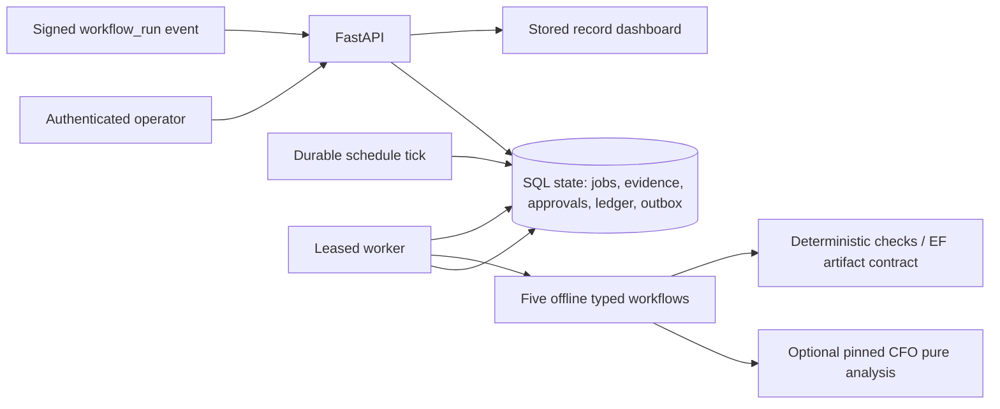

# Architecture and ADRs

Status: local MVP design. Source baseline: `CAPABILITY_MATRIX.md`. Evidence and
unknowns remain distinct. No paid model, customer, or production claims.

## ADR-001: Modular monolith / SQL queue

One Python application, SQLAlchemy, explicit Alembic migrations, SQLite local and
PostgreSQL deployment. Serialized queue control transaction per database protects
claim concurrency, reservations, dedupe and outbox insertion. PostgreSQL row lock;
SQLite write transaction. No measured throughput need justifies Redis, Temporal,
Kubernetes or a vector DB. Measure contention before changing this choice.

## ADR-002: Narrow integration and license boundaries

CFO public MIT functions `ci_audit.analyze_export` / `render_report` are the stable
read-only surface at audited revision. Optional pinned dependency, with explicit
offline fallback identified in evidence. No patch/worktree execution.
The engineering adapter rewrites recommendations that would quarantine, disable,
delete, skip, or de-block required checks before rendering its Markdown report.
EF proprietary service stays separate; import versioned deterministic evaluation
results, validate them, and block failed/unknown results independently of judge.
WNRT private AGPL stays separate; import redacted evidence, never launch network
remediation. No source copied, bundled, or relicensed from these two projects.

## ADR-003: Reliable effects, not exactly-once claims

Submission dedupe is scoped to tenant and immutable request digest. Every claim
increments attempts and receives a unique lease token. Completion, heartbeat,
retry and report commit require matching token and unexpired lease. Expiry leads
to bounded retry or DEAD_LETTER. Event/job/outbox records commit atomically.
External dispatch is initially disabled; approved local deliverable packaging is
the first effect. Future network senders must use effect idempotency keys and
handle ambiguous remote success explicitly.

## ADR-004: Costs and authority fail closed

Integer micro-USD arithmetic, tenant limit with reservation/spend accounting.
Offline tasks cost zero; a reservation does not prove provider usage. No client
can set a cheaper price for a paid provider. No paid adapter is enabled.
Trusted identity config supplies tenant, actor and role. Payloads cannot self-grant
customer authorization. Operator approval binds full action payload, resource,
actor and expiry. Production startup must refuse local token authentication until
verified identity/TLS/managed secrets are implemented.
Global and per-tenant kill switches stop new admission and worker claims. ASGI
request limits cap both declared and streamed request bodies at 1 MB.

## ADR-005: Evidence and business truth

Every completion links to sanitized input and output hashes, workflow/version,
deterministic evaluation and mode OFFLINE_DEMO / IMPORTED / LIVE_VERIFIED.
Generated text is a proposal until human sign-off. Ledger events need source
references and explicitly distinguish operator-attested records from verified
bank evidence. USD149 is a pricing experiment, never inserted as earned revenue.

## Deployment shape

Compose API on 127.0.0.1, worker/scheduler, PostgreSQL without host port. Migrate
before service startup; health/readiness plus schema checks. Azure Container Apps
Consumption is optional preparation: external PostgreSQL, managed secrets,
scheduled/event jobs and scale-to-zero require a tested trigger design. Polling a
SQL queue alone does not wake a scaled-to-zero worker. No Azure deploy command is
run without explicit approval.
